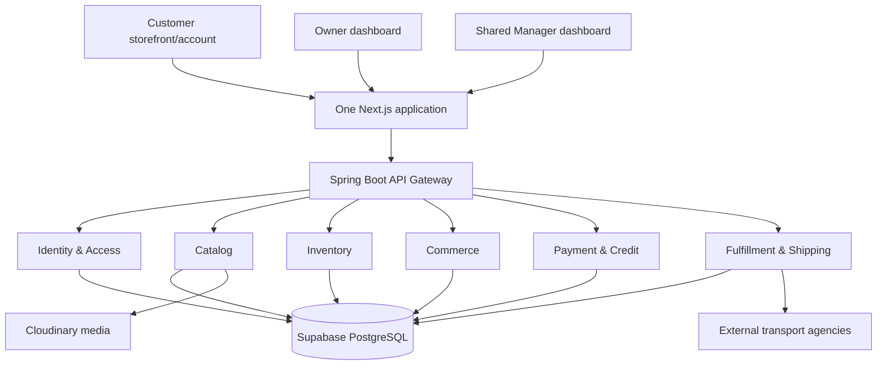

# D & Z Fashion — architecture at a glance

## One application, three experiences

## Business service ownership

| Service | Owns |
|---|---|
| Identity & Access | Customers, staff accounts, roles, credentials, OTP, sessions and security events |
| Catalog | Dynamic categories, product definitions, variants, pricing, revision approvals and media metadata |
| Inventory | Surat warehouse stock, stock movements, reservations, release and low-stock threshold |
| Commerce | Cart, checkout orchestration, orders, order snapshots, cancellations and claim workflow orchestration |
| Payment & Credit | Simulated payment records, COD payment ledger, store-credit ledger, refunds and settlement financial records |
| Fulfillment & Shipping | Picking, packing, dispatch batches, agencies, manual statuses, delivery attempts, return intake and exchange logistics |

The API Gateway routes traffic but owns no business data. Notifications, audit, support and reports begin as bounded modules/read models in the appropriate service; split later only with an ADR and owner approval.

## Storage responsibility

Supabase PostgreSQL is the relational database. Each service owns a dedicated schema and Flyway migrations. Cloudinary is image/media object storage; its public IDs and metadata are stored in PostgreSQL. This is one database plus media storage, not two SQL databases. The open decision about a second actual database must be resolved before one is introduced.

## Communication

Use REST for immediate operations. Use a transactional outbox and idempotent consumer pattern for durable cross-service events. Do not add Kafka/RabbitMQ/Redis in phase one without evidence and an approved ADR. Avoid distributed transactions; coordinate checkout/reservation/payment/fulfillment with state transitions and compensating actions.
